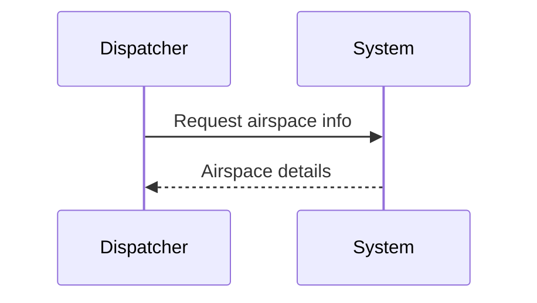
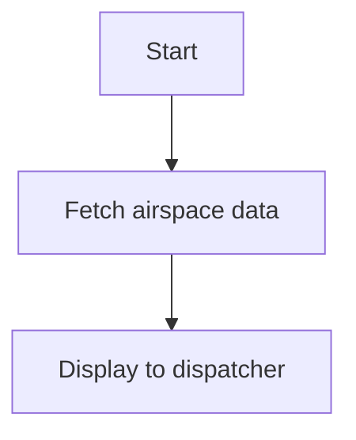

# demo-plan

> Generated by kb plan-ingest at unknown-commit — do not edit by hand.

## T-free TAL-1580 — Show restrictive airspace details

> Revision: 1

### Summary
Dispatchers need restrictive airspace details while planning a route.

### User Story
As a dispatcher, I want to see restrictive airspace details, so that I can brief the flight crew accurately.

### Background / Business context
Restrictive airspace records define designation, type, and level.

### Acceptance Criteria
- [ ] AC1: Given a restrictive airspace polygon, when the dispatcher clicks it, then its type and level are shown per [arinc-kb:arinc-424 §5.3]
- [ ] AC2: Given the same polygon, when the panel opens, then the ICAO designation is shown per [icao-kb:icao-annex-2 §1.1]

### Use cases
#### Main flow
Dispatcher opens the map and clicks the airspace polygon.

#### Alternate / exception flows
No restrictive airspace nearby: show nothing.

### Sequence diagram


### Business flow


### Dependencies
- Blocked by: None
- Blocks: None

### Non-functional requirements
| Concern | Target | How to measure | Source |
|---|---|---|---|
| Detail render | Details visible within 2 s of polygon click | Stopwatch check on staging | team SLA |

### UI / presentation spec
Side panel lists designation, type, and level as labeled rows; empty state shows 'No restrictive airspace nearby'.

### Out of scope
Editing airspace records.

### Test data & verification
Sample record with designation R-2905A: expect type 'R' and level 'L1' shown in the panel.

### Technical grounding
- Grounded on: demo:demo-code @ c12b24f
- Service: svc.airspace-service
- Files:
  - src/airspace/service.py
- Tables: db.restrictive_airspace.designation
- Routes: none
- Externals: none
- Verify with: cmd.test — `pytest -q --cov=airspace`
- Open decisions:
  - none

### Open questions
- [ ] Q1 — Confirm the polygon fill color token — owner: design-team — blocks: UI spec

### KB context
```yaml
kb-context:
  version: "HUB"
  refs:
    - arinc-kb:arinc-424 §5.3
    - icao-kb:icao-annex-2 §1.1
  tags: [airspace]
```
